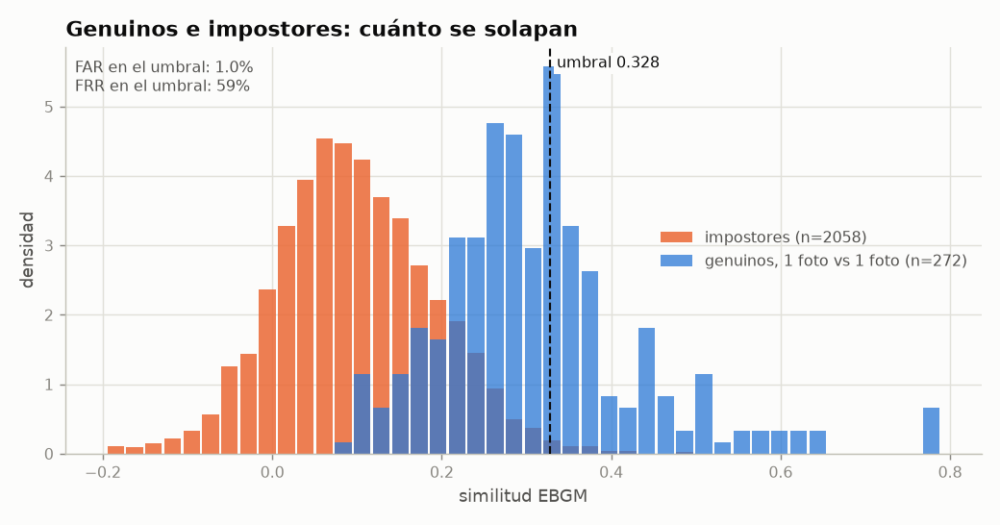
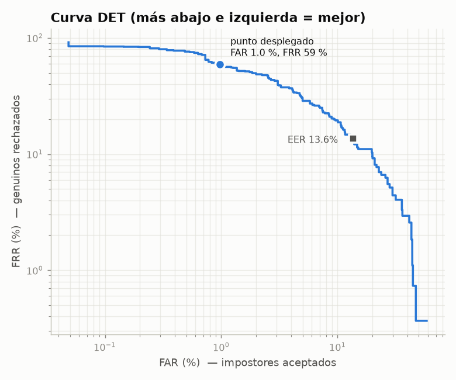
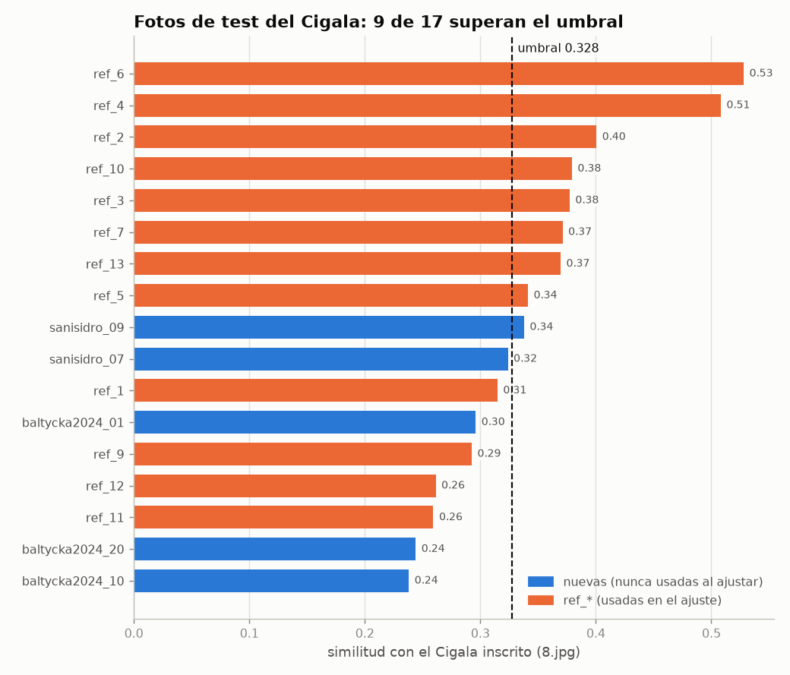
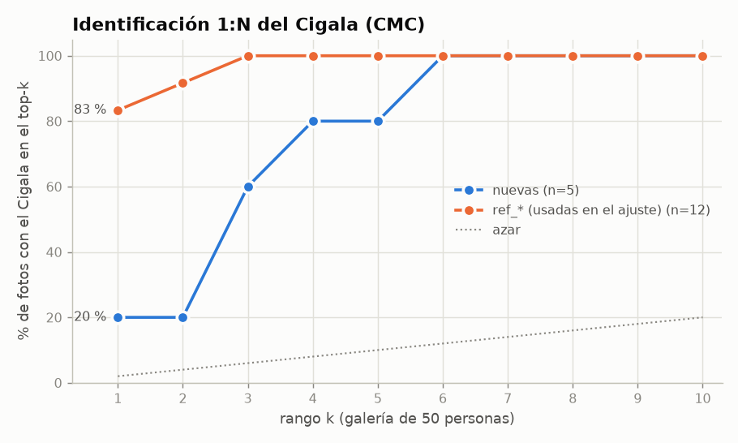
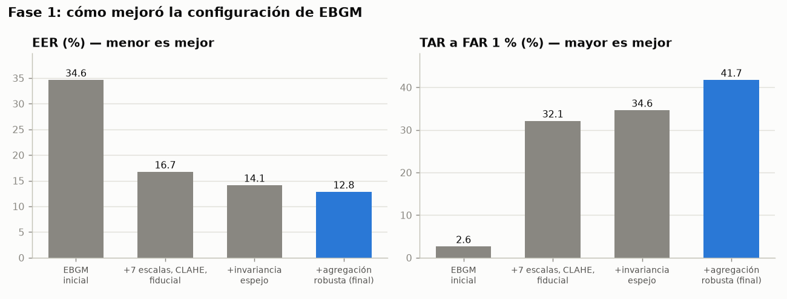
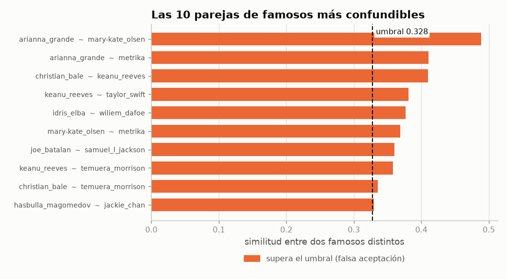
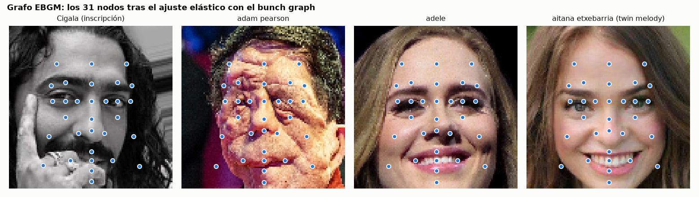

# Reconocimiento facial EBGM — Sistemas Biométricos

El sistema de reconocimiento facial usa como método 
**EBGM (Elastic Bunch Graph Matching)**: un grafo de nodos fiduciales sobre la
cara, jets de Gabor en cada nodo, un *Face Bunch Graph* para ajustar el grafo a
cada cara y un emparejamiento de grafos para comparar.

Nuestro famoso elegido es **El Cigala**. La BD tiene **50 personas**: los 49
famosos de `datos/Dataset.tar.gz` más el Cigala.

### Fotos: hay más fotos que personas, pero cada persona se inscribe con UNA

El enunciado limita las **personas inscritas**, no las fotos del repositorio.
La BD tiene **una fila (un template) por persona**, y **cada persona, también
el Cigala, se inscribe con una sola foto**. El resto de fotos no se inscribe:

| Carpeta | Fotos | Uso |
|---|---|---|
| `datos/Dataset/` | 49 | 1 por famoso: es su foto de inscripción |
| `datos/fotos_cigala/` | **1** (`8.jpg`) | La foto de inscripción del Cigala |
| `datos/fotos_cigala_test/` | 19 | **Solo para pruebas**, nunca se inscriben: 7 fotos **nuevas** (conciertos y otras épocas) y 12 `ref_*.jpg`, que se usaron para **ajustar** la configuración en la fase 1. La evaluación informa de los dos grupos por separado |

Así el Cigala está en las mismas condiciones que los 49 famosos.

```
foto -> [DETECTOR YuNet] -> cara 112x112 alineada -> [EXTRACTOR EBGM] -> template -> [MATCHER EBGM] -> BD (.csv)
```

| Etapa | Fichero | Qué hace |
|---|---|---|
| Detector | [`reconocimiento/detector.py`](reconocimiento/detector.py) | YuNet (OpenCV). Detecta la cara y la **alinea** a 112×112 con 5 landmarks. Lee JPG/PNG/WebP/AVIF/HEIC. |
| Extractor + matcher | [`reconocimiento/ebgm.py`](reconocimiento/ebgm.py) | **EBGM**: CLAHE → Gabor 7×8 → grafo fiducial de 31 nodos → ajuste elástico con el *bunch* → jets → similitud. |
| Sistema + BD | [`reconocimiento/sistema.py`](reconocimiento/sistema.py) | Los **9 métodos** del enunciado y la BD `.csv` (templates cifrados y firmados). |
| Modelo / BD | [`scripts/inscribir_dataset.py`](scripts/inscribir_dataset.py) | Entrena el modelo EBGM, inscribe las 50 personas y calibra los umbrales. |
| Ajuste (fase 1) | [`scripts/ajuste_ebgm.py`](scripts/ajuste_ebgm.py) | Banco de experimentos con el que se eligió la configuración. |
| Evaluación (fase 2) | [`scripts/evaluar.py`](scripts/evaluar.py) | EER, d', FAR/FRR, CMC, robustez, riesgos y tiempos del sistema desplegado. |
| Seguridad (fase 2) | [`scripts/evaluar_ataques.py`](scripts/evaluar_ataques.py) | 23 ataques ejecutados de verdad (saltar etapas, leer BD, escribir BD). |

## Puesta en marcha

### Con Docker (recomendado)

```bash
docker build -t ebgm .
```

```bash
docker run --rm ebgm
```

```bash
docker run --rm ebgm python scripts/evaluar.py
```

```bash
docker run --rm ebgm python scripts/evaluar_ataques.py
```

El build descarga YuNet (verificando su sha256), entrena el modelo e inscribe a
las 50 personas: el contenedor arranca listo. Por defecto ejecuta la demo.

### En local

```bash
python -m venv .venv
.venv\Scripts\activate            # Linux/Mac: source .venv/bin/activate
pip install -r requirements.txt
python scripts/download_models.py     # YuNet en models/ (sha256 verificado)
python scripts/inscribir_dataset.py   # modelo EBGM + BD de 50 personas + umbrales
python scripts/demo.py                # los 9 métodos funcionando
```

## Los 9 métodos

```python
from reconocimiento import SistemaReconocimiento   # desde la raíz del repo
sis = SistemaReconocimiento()

sis.inscribir("ana", "ana.jpg")            # -> {'inscrito': 'ana', 'posible_duplicado': None}
sis.verificar("ana", "otra_ana.jpg")       # -> {'verificado': True}
sis.identificar("quien.jpg")               # -> {'id': 'ana', 'aceptado': True}

# modo evaluación (similitudes + ranking top-5), p. ej. para curvas DET:
ev = SistemaReconocimiento(exponer_puntuaciones=True)
ev.verificar("ana", "otra_ana.jpg")        # -> {'verificado': True, 'similitud': 0.45, 'umbral': 0.33}

cara = sis.extraer_cara("foto.jpg")        # recorte 112x112 alineado (entrada de los _sd)
sis.inscribir_sd("ana", cara)              # omite el detector
sis.verificar_sd("ana", cara)
sis.identificar_sd(cara)

tpl = sis.extraer_template("foto.jpg")     # template EBGM (entrada de los _t)
sis.inscribir_t("ana", tpl)                # omite detector y extractor
sis.verificar_t("ana", tpl)
sis.identificar_t(tpl)
```

| Método | Entra por | Omite |
|---|---|---|
| `inscribir` / `verificar` / `identificar` | foto (ruta, bytes o `np.ndarray` BGR) | — |
| `inscribir_sd` / `verificar_sd` / `identificar_sd` | cara recortada y alineada 112×112 | detector |
| `inscribir_t` / `verificar_t` / `identificar_t` | template (`np.ndarray` (31, 58) o su serialización base64) | detector y extractor |

- `identificar` es de **conjunto abierto**: devuelve `id=None` si la mejor
  similitud no supera el umbral (la persona no está inscrita).
- `inscribir*` **no sobrescribe** un id existente salvo con `sobrescribir=True`,
  y avisa de `posible_duplicado` si esa cara ya está inscrita con otro nombre.
- `verificar*` responde igual para un id que no existe que para un rechazo, así
  que no revela quién está inscrito.
- Los errores controlados lanzan `ErrorDeteccion` (no hay cara, varias caras al
  inscribir, imagen inválida) o `ErrorSistema` / `ErrorCalidad` (id inválido,
  template inválido, entrada que no parece una cara, BD comprometida).
- **Por defecto no se devuelven similitudes ni ranking**, solo la decisión:
  así se frena el *hill-climbing*. `exponer_puntuaciones=True` las devuelve
  (modo evaluación). Otras opciones del constructor: `estricto=False` (no bloquear si la
  integridad de la BD falla), `umbral=...` (otro punto de operación).

Línea de comandos (añade `--puntuaciones` para ver similitudes):

```bash
python -m reconocimiento.sistema identificar --foto x.jpg
python -m reconocimiento.sistema verificar --id cigala --foto x.jpg
python -m reconocimiento.sistema listar
```

## El método: EBGM

1. **Preprocesado.** CLAHE (ecualización local de contraste).
2. **Wavelets de Gabor.** 7 escalas (λ = 5…40 px) × 8 orientaciones, kernels
   complejos con compensación de DC (Wiskott). El **jet** de un punto es el
   vector de 56 magnitudes.
3. **Grafo fiducial.** 31 nodos en ojos, comisuras, cejas, ojeras, nariz,
   aletas, boca, mentón, pómulos, mandíbula y frente, simétricos izquierda/derecha.
4. **Face Bunch Graph.** Para cada nodo, el «manojo» de jets de esa posición en
   las 49 caras de la cohorte (más sus espejos). Al extraer, cada nodo se
   desplaza elásticamente (±3 px) hasta donde su jet mejor encaja en el manojo,
   con penalización de deformación y regularización con sus vecinos.
5. **Template.** Los 31 jets más la posición de cada nodo: matriz (31, 58).
6. **Matcher.** Coseno, nodo a nodo, entre jets comprimidos (√) y normalizados
   por la cohorte (z-score por nodo y filtro). Las similitudes de los nodos se
   agregan de forma **robusta**: se calcula cada media cara (lado + eje
   central) descartando sus 3 nodos peores y se toma la mejor, lo que tolera
   giros de cabeza y oclusiones parciales (gafas, pelo, barba). Es además
   **invariante a espejo**: se compara también con el grafo reflejado de la
   sonda y se toma el máximo.

El **modelo** (`models/ebgm_modelo.npz`: manojo, media/desviación de la cohorte y
umbrales) es común a todas las identidades. Todas las personas, el Cigala
incluido, se inscriben con **una sola foto** (1 template por persona).

### Cómo se eligió la configuración (fase 1)

`python scripts/ajuste_ebgm.py` compara variantes **sin tocar el test**
(las 7 fotos nuevas de `datos/fotos_cigala_test/` solo se usan para evaluar). Genuinos de
ajuste: los 156 pares ordenados entre 13 fotos del Cigala (la de inscripción y las 12 `ref_*`; caso real «1 foto
inscrita») y 392 fotos degradadas de los famosos. Impostores: famosos entre sí y
Cigala contra famosos.

| Ajuste (1 foto inscrita) | EBGM inicial (5 escalas, rejilla 9×8) | **EBGM final** |
|---|---|---|
| EER del Cigala | 34,6 % | **12,8 %** |
| d' del Cigala | 0,65 | **2,14** |
| Rank-1 del Cigala (galería de 50) | 19 % | **51 %** |
| TAR @ FAR 1 % del Cigala | 2,6 % | **41,7 %** |
| EER de las degradaciones | 4,6 % | **0,3 %** |
| Rank-1 de fotos en espejo | — | **98 %** |

Lo que más aportó: **7 escalas** (las escalas grandes capturan la forma de la
cara), **CLAHE** (mejor que Tan-Triggs), **grafo fiducial**, **matcher
invariante a espejo** y **agregación robusta de nodos**. Lo que se probó y **se
descartó** por no mejorar: Tan-Triggs, simetrizar el template, rejilla densa,
término de geometría, compresión logarítmica, 8 escalas, 12 orientaciones,
micro-variaciones al inscribir, normalización T-norm, pesos por nodo aprendidos
y WCCN. El detalle, ronda a ronda, está en [`docs/INFORME.md`](docs/INFORME.md).

## Resultados (fase 2) — `python scripts/evaluar.py`

Sistema desplegado: umbral **0,327** (FAR objetivo 1 %).

| Métrica | Resultado |
|---|---|
| FTA del detector | 0/49 famosos, 2/19 fotos de test del Cigala (fotos de concierto con caras de ~20 px) |
| Fotos de test del Cigala vs el Cigala de la BD (1 foto) | **9–10 de 17 aceptadas** (según la versión de OpenCV); rank-1 65 %, **rank-5 94 %**; 4/17 identificadas como otra persona |
| … solo las 5 **nuevas** (nunca usadas al ajustar) | **1–2 de 5 aceptadas** (una cae justo en el umbral: 1/5 con OpenCV 5, 2/5 en Docker con OpenCV 4); rank-1 20 %, rank-5 80 % |
| … solo las 12 `ref_*` (usadas al ajustar) | 8 de 12 aceptadas; rank-1 83 %, rank-5 100 % |
| Protocolo «1 foto vs 1 foto» (272 pares entre fotos de test) | EER 13,6 %, d' 2,0, **TAR@FAR1 % = 41 %** |
| FAR real en el umbral desplegado | 1,0 % |
| Robustez (iluminación, baja resolución, JPEG 15, giro 12°, ruido, luz lateral) | **100 %** rank-1 y verificación |
| Robustez espejo | 98 % |
| Tiempo `verificar` / `identificar` (foto) | ~100 ms (`_t` < 1 ms) |

**Lectura honesta.** Con **una sola foto inscrita** por persona y fotos nuevas
muy distintas (otro evento, otra década, perfil, gafas de sol), EBGM, que es un
método clásico, se queda en un TAR de ~40 % a FAR 1 %: una foto nueva de un
famoso tiene bastante probabilidad de ser rechazada, y alguna de ser confundida
con otra persona. La persona correcta suele estar entre las 5 primeras
(rank-5 80 % en el test del Cigala), pero no siempre la primera. Frente a
cambios de captura de la misma foto (luz, resolución, compresión, ruido, giro)
el sistema es muy robusto.

## Gráficas — `python scripts/graficas.py`

Genera 9 figuras en `salida/graficas/` con la BD y el umbral reales
(distribuciones, curva DET, fotos de test, CMC, robustez, parejas confundibles,
evolución del ajuste, grafo EBGM y banco de Gabor). Con Docker, montando
`salida/` para recogerlas (PowerShell):

```powershell
docker run --rm -v "${PWD}/salida:/app/salida" ebgm python scripts/graficas.py
```

| | |
|---|---|
|  |  |
|  |  |
|  |  |



## Seguridad — `python scripts/evaluar_ataques.py`

Defensas: templates **cifrados en reposo** (AES-256-GCM); HMAC por fila + MAC
global (detecta filas alteradas, añadidas, intercambiadas, borradas o
restauradas); BD ligada al hash del modelo, que lleva dentro los umbrales; modo
estricto que falla en cerrado; validación de ids (incluida la inyección de
fórmulas CSV) y de templates; control de «caricidad» EBGM en `_sd`/`_t`;
respuestas sin puntuaciones y sin enumeración de ids; no sobrescritura; aviso de
duplicados; auditoría (`salida/auditoria.log`); sha256 fijado del detector;
escritura atómica.

**16 de 23 ataques bloqueados**; los **7 restantes son vulnerabilidades
CONOCIDAS**, cada una con su mitigación (detalle en [`docs/INFORME.md`](docs/INFORME.md)).

## Estructura

```
├── reconocimiento/            # EL SISTEMA (paquete Python)
│   ├── detector.py            #   etapa 1: detección + alineado (YuNet)
│   ├── ebgm.py                #   etapas 2-3: extractor y matcher EBGM
│   ├── sistema.py             #   los 9 métodos + BD .csv cifrada y firmada
│   └── rutas.py               #   todas las rutas del proyecto
├── scripts/                   # LO QUE SE EJECUTA
│   ├── download_models.py     #   descarga YuNet (sha256 verificado)
│   ├── inscribir_dataset.py   #   modelo EBGM + inscripción de 50 personas + calibración
│   ├── demo.py                #   demostración de los 9 métodos
│   ├── ajuste_ebgm.py         #   fase 1: experimentos de ajuste
│   ├── evaluar.py             #   fase 2: métricas del sistema desplegado
│   ├── evaluar_ataques.py     #   fase 2: ataques
│   └── graficas.py            #   figuras del sistema -> salida/graficas/
├── datos/
│   ├── Dataset/ (+ .tar.gz)   #   49 famosos del docente
│   ├── fotos_cigala/          #   1 foto: la de inscripción del Cigala
│   ├── fotos_cigala_test/     #   19 fotos solo para pruebas (7 nuevas + 12 ref_*)
│   └── bd_sistema.csv (+.mac) #   la BD (generada, no versionada)
├── models/                    # YuNet, ebgm_modelo.npz, calibracion.json (+ clave_bd.key generada)
├── salida/                    # graficas/, auditoria.log, caché del ajuste
├── docs/INFORME.md            # informe de las fases 1 y 2
├── Dockerfile
└── requirements.txt
```

## Notas

- La BD (`datos/bd_sistema.csv`, `.mac`) y la clave (`models/clave_bd.key`)
  **se generan** con `python scripts/inscribir_dataset.py` (o en el
  `docker build`) y no se versionan: cada despliegue tiene su propia clave. En
  producción, pasa la clave por entorno: `EBGM_CLAVE_BD=<64 hex>`.
- Si se cambia `ConfigEBGM`, hay que re-ejecutar `scripts/inscribir_dataset.py`: los
  templates llevan la huella de la configuración y no se mezclan.
- Rutas con tildes/ñ en Windows: imágenes y modelos se leen por buffers.
